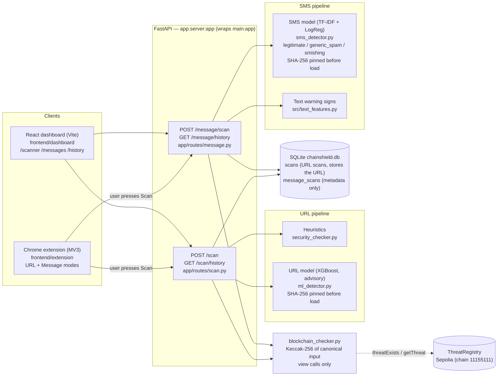
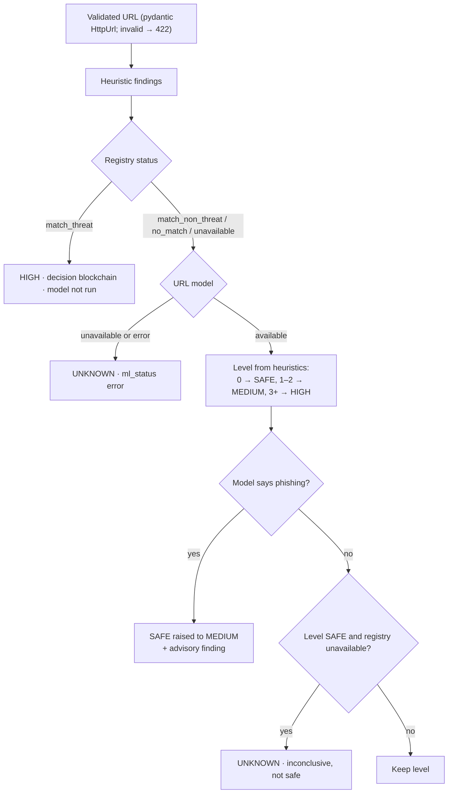
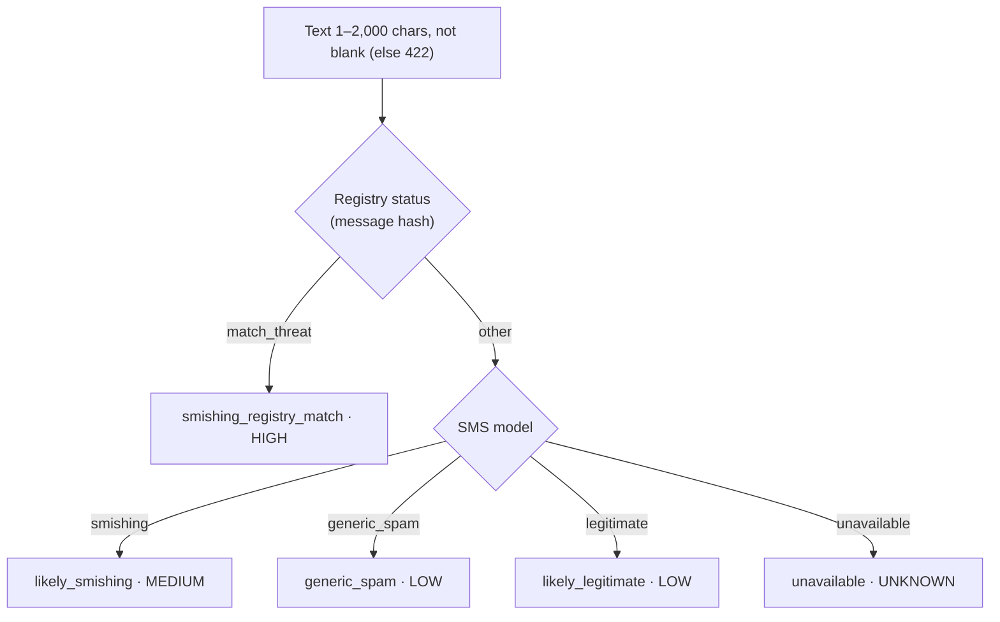

# ChainShield — Architecture

Drawn from the code as of 2026-10-28 (`app/server.py`, `main.py`, `app/routes/`,
`app/services/`, `app/database/`, `frontend/`). Diagrams use Mermaid.

## Components

The backend never writes to the chain. Threat records are added only by the contract
owner with the separate seeder (`src/blockchain/seed_registry.py`, dry-run by default).

## URL decision (`app/routes/scan.py`)

## Message decision (`app/routes/message.py`)

A message result is never `SAFE`. Message text is used in memory only; history stores
verdict, model scores, registry status, length and a has-link flag.

## Registry statuses

| Status | Meaning | Shown as threat? |
|---|---|---|
| `match_threat` | hash registered with verdict 1 | yes |
| `match_non_threat` | hash registered with another verdict | no |
| `no_match` | registry reachable, hash absent | no (not proof of safety) |
| `unavailable` | RPC, chain ID, contract or call could not be verified | no (inconclusive) |
| `match_unclassified` | older history row: entry existed, verdict not recorded | no |
| `not_recorded` | older history row: no registry data saved | no |
